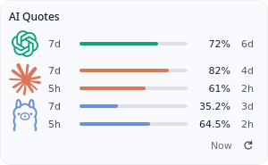
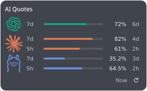

# AIProviderQuota

[English](README.md) | **Português**

Widget para **KDE Plasma 6** que reúne as cotas disponíveis do **Codex**, **Claude** e **Ollama Cloud** em um cartão compacto.

| Claro | Escuro |
| --- | --- |
|  |  |

*Prévia com dados fictícios. Ambos os temas usam 82% de opacidade no fundo.*

## Recursos

- Lista vertical com ícones dos provedores, barras de quota disponível e tempo até a renovação.
- Até duas janelas por provedor: `7d` e `5h`, quando disponíveis. A sessão do Ollama aparece como `5h`.
- Reset em uma única unidade: `1w`, `4d`, `2h` ou `30m`.
- Temas Automático, Claro e Escuro; opacidade do fundo ajustável de 0 a 100%.
- Cartão responsivo sem rolagem. Linhas ocupam o espaço disponível; textos e ícones aumentam preservando um tamanho mínimo legível.
- Título editável com alinhamento Left, Center, Right ou Disabled. Desativá-lo remove o espaço do cabeçalho.
- Detalhes completos dos provedores no tooltip, por hover ou foco de teclado.
- Rodapé com o botão de atualizar à direita e a idade do dado mais antigo imediatamente ao lado.
- Atualização automática a cada dois minutos, configurável entre 1 e 15 minutos.
- Representação compacta para o painel, com ícones distintos e nomes/valores acessíveis ao leitor de tela.

O widget acompanha as **assinaturas e ferramentas** dos provedores. Cada barra representa a porcentagem **restante** da janela informada pela conta. O Ollama também aceita contas com franquia mensal em dólares, mantendo os créditos extras separados.
Quando a conta informa apenas um saldo em dólares, o valor aparece sem barra de percentual.

## Requisitos

- Linux com KDE Plasma 6 e Qt 6. Validado em CachyOS, Plasma 6.8 e Wayland.
- Python 3, `kpackagetool6` e `qdbus6`.
- Codex CLI e Claude Code já autenticados, para acompanhar esses provedores.
- KWallet, `kwallet-query` e uma chave de API do Ollama Cloud, para acompanhar o Ollama.
- `kdialog` para configurar a chave pela interface; módulo Python `dbus` para criar inicialmente a pasta no KWallet.

No CachyOS/Arch, `kpackagetool6`, `qdbus6`, `kwallet-query` e `kdialog` são fornecidos, respectivamente, pelos pacotes `kpackage`, `qt6-tools`, `kwallet` e `kdialog`. O módulo `dbus` vem de `python-dbus`.

## Instalação

```bash
git clone https://github.com/leozdev/AIProviderQuota.git
cd AIProviderQuota
bash install.sh
```

Depois, abra **Adicionar widgets** no Plasma, procure **AI Quotes** e coloque o widget na área de trabalho ou no painel.

O instalador usa o pacote em `package/` e instala somente para o usuário atual, sem `sudo`. Se o widget já estiver instalado, ele será atualizado. Os pacotes do sistema não são instalados nem atualizados pelo script.

### Atualização

```bash
git pull --ff-only
bash install.sh
```

Se o widget já estiver carregado, o Plasma pode manter o QML anterior em memória. Recarregue o `plasmashell` ou saia e entre novamente na sessão para carregar a interface atualizada. O instalador não reinicia o Plasma automaticamente.

A nova interface e as mensagens de novas coletas estão em inglês. Textos de um relatório antigo em cache podem continuar em português até que ele seja substituído; a atualização não limpa o cache nem força consultas adicionais aos provedores.

## Contas e fontes de quota

| Provedor | Autenticação e fonte |
| --- | --- |
| Codex | Reutiliza o login do cliente local e consulta `account/rateLimits/read` pelo `codex app-server`. Pode recorrer a um registro de sessão recente, identificado como tal. |
| Claude | Reutiliza o OAuth do Claude Code e consulta `https://api.anthropic.com/api/oauth/usage`. **Esse endpoint é interno e pode mudar.** A renovação do login continua sob responsabilidade do Claude Code. |
| Ollama Cloud | Consulta `https://ollama.com/api/balance` com uma chave guardada no KWallet. |

Para configurar o Ollama, clique com o botão direito no widget, abra as configurações e use **Configure Ollama key** na página **General**. A entrada é feita em um diálogo de senha do KDE.

A chave fica na pasta `AI Quotas`, entrada `ollama-cloud-api-key`, da carteira de rede padrão. Também é possível configurá-la pelo terminal, com entrada interativa:

```bash
python3 package/contents/code/quota_collector.py --configure-ollama

# Para substituir uma chave existente:
python3 package/contents/code/quota_collector.py --configure-ollama --replace
```

Com a carteira bloqueada, o widget informa que ela precisa ser desbloqueada. A atualização automática não tenta abrir repetidamente um diálogo de senha.

## Aparência e uso

Nas configurações, selecione os provedores, o intervalo de atualização, o tema e a opacidade do fundo. O padrão acompanha as cores do Plasma e usa **82% de opacidade**. A transparência afeta o fundo; textos e ícones mantêm sua nitidez. A representação no painel segue as cores do próprio painel.

- Passe o mouse ou use Tab para focar um provedor e ver todas as janelas, datas completas de reset, origem, idade da coleta e estado. As linhas não expandem ao clicar.
- Configure o texto e o alinhamento do título. Um campo vazio usa **AI Quotes**; o texto personalizado é preservado ao desativar o título.
- Ajuste **Font size (pt)** para os textos do corpo, de 6 a 24 pt (padrão: **8 pt**). Esse tamanho base acompanha a escala do widget. O título mantém a fonte do Plasma.
- Em **Card elements**, habilite ou desabilite separadamente o ícone do provedor, o período da quota, a barra, o valor e o tempo até o reset. As cinco opções vêm ativadas. O valor representa a quota restante (percentual ou saldo). Essas opções valem para o cartão completo; os detalhes permanecem no tooltip do provedor.
- O rodapé mostra **Now** para dados com menos de um minuto; depois, `1m`, `2m`, `1h`, `1d` ou `1w`. O texto muda nas viradas de minuto dos dados, independentemente das consultas. Ele usa o timestamp mais antigo: cache ou falha parcial podem manter uma idade maior mesmo após atualizar. Sem timestamp, mostra `—`.
- Use o botão de atualizar para solicitar uma nova consulta.
- No painel, o indicador mostra a janela com menor percentual disponível de cada provedor.
- Se essa janela não estiver entre as duas barras, a dica identifica a quota mais restritiva. O tooltip mostra todas as janelas retornadas.

O título personalizado vale para o cartão completo; o indicador do painel mantém o nome padrão. Os textos estão em inglês; números e datas seguem a localidade do sistema.

Alterações na seleção de provedores durante uma consulta entram na coleta seguinte, iniciada assim que a consulta atual termina.

## Falhas e privacidade

A coleta consulta as quotas sem enviar prompts aos modelos. Cada provedor possui estado próprio; respostas HTTP 429 respeitam o tempo de espera indicado pelo provedor. A coleta tem um prazo total de 20 segundos, preservando os resultados concluídos se outro provedor demorar demais. Instâncias simultâneas aguardam a coleta em andamento e reutilizam seu cache recente dentro desse mesmo prazo.

Em uma falha temporária, o último valor válido pode aparecer por até dez minutos, marcado como antigo e mantendo o horário original. Quando uma janela atinge o reset, o percentual deixa de ser mostrado até uma nova resposta válida. Uma autenticação recusada pelo Claude ou Ollama invalida os valores em cache daquele provedor.

No Codex, erros do RPC não distinguem uma recusa de autenticação de outras falhas: o coletor pode usar um registro local recente, identificado como tal, ou o cache marcado como antigo. Esses dados também expiram em dez minutos e não confirmam que o login continua ativo.

O cache fica em `~/.cache/ai-quotas/` e contém quotas e horários. Tokens e a chave do Ollama não são incluídos nesses relatórios. As credenciais do Codex e Claude permanecem sob controle dos respectivos clientes; a chave do Ollama é lida do KWallet.

## Desenvolvimento e validação

O coletor Python usa a biblioteca padrão na coleta normal e entrega JSON normalizado ao QML. A interface fica em `package/contents/ui/` e o coletor em `package/contents/code/quota_collector.py`. A versão enviada às fontes vem de `package/metadata.json`.

Os testes unitários usam respostas simuladas e não precisam de contas:

```bash
python3 -m unittest discover -s tests -p 'test_*.py' -v
```

Para verificar o QML, use o `qmllint` da instalação Qt 6:

```bash
/usr/lib/qt6/bin/qmllint package/contents/ui/*.qml \
  package/contents/ui/config/*.qml package/contents/config/config.qml
```

Os testes gráficos opcionais exigem KWin, PySide6, Pillow, Spectacle e `dbus-run-session`, além do Plasma. Eles criam uma sessão Wayland isolada, sem substituir o compositor do usuário:

```bash
# Renderização com dados fictícios, sem consultar as contas:
python3 tests/run_wayland_validation.py

# Integração nativa e mudanças durante uma consulta, com dados fictícios:
python3 tests/run_wayland_validation.py --plasma-fixture

# Integração nativa: consulta as contas locais e acessa o KWallet:
python3 tests/run_wayland_validation.py --plasma
```

Os resultados são gravados em `evidence/`, ignorado pelo Git. O teste visual usa a fixture pública `tests/fixtures/quota-demo.json`; a disponibilidade dos serviços é registrada separadamente dos checks da interface no teste nativo. Os checks automáticos cobrem tempo, geometria, foco, descrições acessíveis, persistência de configurações e propagação do botão direito a um host de teste. Interação com o menu nativo, fluxo Aplicar/Cancelar e leitura assistiva real exigem verificação manual separada.

## Remoção

```bash
bash uninstall.sh
```

O script remove as instâncias de **AI Quotes** e o pacote instalado. Se não conseguir acessar a sessão do Plasma, avisa e continua removendo o pacote. A chave do Ollama é preservada no KWallet. Para apagá-la, remova a entrada indicada acima pelo gerenciador de carteiras. O cache pode ser removido separadamente em `~/.cache/ai-quotas/`.

## Limitações

- A disponibilidade das janelas depende da conta e da resposta do provedor.
- O endpoint do Claude é interno; alterações no serviço podem exigir ajustes na integração.
- Antigravity/Gemini ficou para uma etapa futura.

## Autoria, licença e créditos

**AIProviderQuota é desenvolvido e mantido por [Leo Zamparo (leozdev)](https://github.com/leozdev).**

O copyright de 2026 de Leo Zamparo cobre as adições e adaptações do AIProviderQuota. O aviso original de copyright de Marc Cheng e o texto da licença MIT do código reutilizado são preservados em `LICENSE` e `package/LICENSE`.

Código sob [licença MIT](LICENSE). A integração QML/Python e partes do protocolo Codex foram adaptadas de [PlasmaWidgetAiUsage](https://github.com/WariKoda/PlasmaWidgetAiUsage), de Marc Cheng, revisão `1b8fef4f2ca78482d8ca289a4204f02e5c51e111`. Marc é creditado como autor dessa base reutilizada. Os detalhes de procedência estão em [NOTICE](NOTICE).

A procedência dos ícones está documentada em [ATTRIBUTION.md](package/contents/icons/ATTRIBUTION.md). As marcas pertencem aos respectivos provedores.
